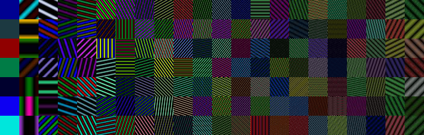

# Fourier Basis DB



## Python environment

Use Python 3.12.16 and uv 0.13.6 or newer. In a fresh checkout:

```bash
git submodule update --init --recursive
uv sync --locked
source .venv/bin/activate
```

The lock includes the supported runtime and test dependencies. On Linux it uses
PyTorch's official CPU wheels; no GPU is needed to generate these datasets.
Current PyTorch does not publish Intel macOS wheels, so this locked environment
must run on Linux or another platform with supported wheels. Do not downgrade
PyTorch to restore Intel Mac support. The Linux CI tests the real image commands;
the Hydra configuration tests can also run without PyTorch.

For an existing checkout, keep its environment and data until the new environment
passes the tests. A locally untracked `.python-version` may conflict with the new
tracked file: back up that file before applying this branch. Do not overwrite it
silently. This migration does not uninstall any system Python.

```bash
uv run pytest -q
uv pip check
```

The documented `generate.py` and `show_sample.py` commands are maintained;
`generate_old.py` is a historical script and is not covered by this environment.

## Usage

### Generating Fourier Basis DB

The script `apps/generate.py`
generates Fourier Basis DB (FBDB).

Example code:
```
cd apps
python generate.py metric=freq norm_type=l2 num_image_per_class=100 num_basis=31 image_size=32
```
will generate 32x32 FBDB by using 31x31 2D Fourier basis. 
The DB is saved under `logs/generate`. Currently, `freq index balance`  are supported for `metric` option and `l2`  or `l1`  is for `norm_type`  option. 

If you want to separate validation from train set.
Please specify `val_ratio` larger than 0.0 like follows.

Example code:
```
cd apps
python generate.py metric=freq norm_type=l2 num_image_per_class=100 num_basis=31 image_size=32 val_ratio=0.1
```

### Showing Sample Images

The script `apps/show_sample.py` 
randomly selects some images form generated FBDB and tiles them in a single image like teaser image of this repo. 

Example code:
```
cd apps
python show_sample.py db_path=[ABSOLUTE_PATH_TO_GENERATED_FBDB] num_image_per_class=7
```
will generate sample_image and result is saved under logs/`show_sample`.
